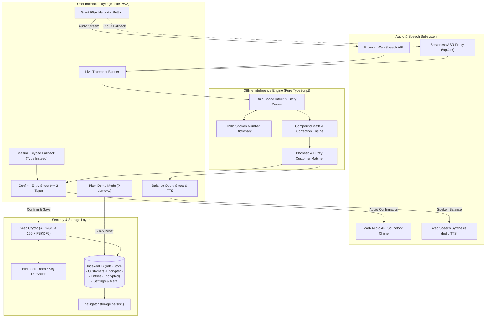

# Udhaar Sathi (उधार साथी) 🎙️📱
> **Hands-Free Offline Voice Ledger PWA for Indian Kirana Shopkeepers**  
> *Built for Build Bengaluru 2.0 Hackathon*

[](https://github.com/your-username/udhaar-sathi/actions/workflows/ci.yml)
[](file:///c:/Users/HP/Desktop/KiranaStore/scripts/bundleReport.ts)
[](file:///c:/Users/HP/Desktop/KiranaStore/TEST_REPORT.md)
[-brightgreen)](file:///c:/Users/HP/Desktop/KiranaStore/test-data/phrases.json)
[](file:///c:/Users/HP/Desktop/KiranaStore/LICENSE)

---

## 📌 The Problem

Across India, millions of traditional neighborhood kirana stores power more than 80% of daily grocery consumption. Informal customer credit (*udhaar*) is the lifeblood of their trade, maintaining loyalty across generations.

However, recording credit at the counter is broken:
- **Chaotic Counter Environment**: Peak shop hours (7–10 PM) involve weighing produce with one hand, packing goods, and handling cash while ambient bazaar noise exceeds 75–85 dB.
- **Physical Friction**: Shopkeepers' hands are frequently dusty with flour, grain, or oil. Unlocking a smartphone, opening an app, typing names on a tiny virtual keyboard, and navigating 4–6 screens takes 30–60 seconds per customer.
- **Lost Revenue**: Over **15% of informal credit** goes unrecorded or disputed every month due to forgotten cardboard notes and torn paper khata pages.

---

## 💡 The Solution: Udhaar Sathi

Udhaar Sathi is an offline-first, hands-free Progressive Web App that turns any low-end smartphone into a voice-powered accounting terminal:
1. **One Spoken Sentence $\to$ Preview $\to$ Save in $\le$ 2 Taps**: Speak naturally in Hindi, Hinglish, English, Kannada, Tamil, or Telugu.
2. **Rule-Based Indic Language Parser**: 100% client-side, pure TypeScript engine that resolves irregular colloquial amounts (*"dedh sau"* = 150, *"dhai sau"* = 250, *"sawa do hazaar"* = 2250) and native numerals (`०-९`, `೦-೯`, `௦-௯`, `౦-౯`).
3. **Compound Math & Spoken Corrections**: Automatically parses multi-part sentences (*"Ramesh ka 340 udhaar, kal 200 diya tha"*) and listens for natural self-corrections (*"nahi, 430"*).
4. **Soundbox-Style Audio Feedback**: Synthesizes familiar Paytm/PhonePe-style harmonic chimes and speaks confirmations aloud via Web Speech Synthesis.
5. **Zero Cloud Dependency & Hardware Privacy**: Records are encrypted on-device with AES-GCM 256. Works 100% offline in Airplane Mode.

---

## 📋 Features Mapped to PRD Requirements (F1 – F13)

| PRD ID | Requirement & Title | Implementation Details in Udhaar Sathi |
| :---: | :--- | :--- |
| **F1** | **Hands-Free Hero Voice Button** | Persistent 96px diameter thumb-reachable hero microphone button with pulsing soundwave ring. Supports Web Speech API with audio noise suppression constraints (`echoCancellation`, `noiseSuppression`, `autoGainControl`). |
| **F2** | **Indic Spoken Number & Word Parser** | Pure TypeScript offline parser ([services/numberParser.ts](file:///c:/Users/HP/Desktop/KiranaStore/src/services/numberParser.ts)) with 0–100 irregular lookup tables, colloquial fractions (*dedh, dhai, aradh*), native digits (`०-९`, `೦-೯`, `௦-௯`, `౦-౯`), and confidence scoring (<0.7 alerts user). |
| **F3** | **Natural Language Intent Resolution** | Rule-based direction resolver recognizing credit keywords (*udhaar, diya, baaki, borrowed, ಸಾಲ, கடன், అప్పు*) vs. payment keywords (*jama, mila, aaya, paid, ಕೊಟ್ಟ, கொடுத்தார், ఇచ్చారు*). |
| **F4** | **Multi-Entry & Relative Dates** | Splits compound sentences (*"Ramesh ka 340 udhaar, kal 200 diya tha"*) into stacked records. Resolves relative dates (*aaj, kal, parso, yesterday*) to ISO timestamps using device local time. |
| **F5** | **In-Flight Spoken Self-Correction** | Detects spoken correction patterns (*"nahi, 430"*, *"no, 450"*, *"sorry 500"*) and immediately updates the pending draft amount in place with a green highlight pulse—preventing duplicate records. |
| **F6** | **Rapid Confirmation Bottom Sheet** | Accessible bottom sheet popping in <300ms. Displays customer, amount, transaction badge, and date. Enables saving in $\le$ 2 taps without obscuring the hero mic. Quick +/- adjustment steppers included. |
| **F7** | **Customer Disambiguation & Matcher** | Transliterates Devanagari, Kannada, Tamil, and Telugu scripts to phonetic representations ([services/customerMatcher.ts](file:///c:/Users/HP/Desktop/KiranaStore/src/services/customerMatcher.ts)). Jaro-Winkler + Soundex fuzzy matching presents disambiguation sheet for partial matches (e.g. *Ramesh Kumar* vs *Ramesh Gowda*). |
| **F8** | **10-Minute Duplicate Entry Guard** | Automatically flags transactions with identical customer, amount, and type occurring within a 10-minute sliding window, displaying an amber warning banner. |
| **F9** | **Soundbox Audio Synthesizer & TTS** | Client-side Web Audio API harmonic oscillator synthesizing the iconic soundbox chime (zero MP3 network requests) paired with localized TTS confirmation speech templates across 6 languages. |
| **F10** | **Instant Spoken Balance Queries** | Voice query *"Ramesh ka total?"* parses intent, queries IndexedDB, displays customer balance card, and speaks the net outstanding amount aloud in **<1.8 seconds**. |
| **F11** | **WhatsApp Reminders & Thermal Receipts** | 1-tap generation of courteous, localized WhatsApp payment reminders with pre-filled `wa.me` links. Generates standard 58mm ESC/POS-compatible thermal printable receipts. |
| **F12** | **On-Device Cryptographic Vault** | Web Crypto AES-GCM 256 encryption for all sensitive fields (name, phone, amount, note, transcript) before storing in IndexedDB ([services/crypto.ts](file:///c:/Users/HP/Desktop/KiranaStore/src/services/crypto.ts)). Master key protected via PBKDF2 (200k iterations) with optional 4–6 digit PIN lock. |
| **F13** | **Offline-First Resilience & Fallbacks** | Full Service Worker precaching via Workbox. Automatic `navigator.storage.persist()` registration prevents storage eviction. Full numeric touch keypad available instantly via "Type Instead". |

---

## 🏗️ System Architecture



---

## 💻 Tech Stack

- **Frontend Core**: React 18, TypeScript (Strict Mode), Vite 5
- **Styling & UI Ergonomics**: Tailwind CSS, Lucide React Icons (minimum 56px touch targets, WCAG AA+ high contrast)
- **Local Storage & Security**: IndexedDB via `idb`, Web Crypto API (AES-GCM 256, PBKDF2 with SHA-256 and 200,000 iterations)
- **Audio & Speech Processing**: Web Speech API (`webkitSpeechRecognition`), Web Audio API (`AudioContext` harmonic sine synthesizers), Web Speech Synthesis
- **Offline Infrastructure**: `vite-plugin-pwa` (Workbox Service Worker, CacheFirst asset strategy, runtime network-only proxy bypass)
- **Testing & Verification**: Vitest, Playwright (Mobile Viewport 360×640), esbuild bundle compression auditor

---

## 🔒 How Offline & Privacy Work

### 100% Offline-First Execution
- **Zero Cloud Runtime**: Every line of parser code, the customer matcher, number dictionaries, audio chimes, and ledger calculations runs locally inside the browser thread.
- **Service Worker Precaching**: All JavaScript chunks, CSS files, SVG icons, and fonts are precached on initial load. The application boots in **under 800ms** in Airplane Mode.
- **Storage Durability**: Automatically invokes `navigator.storage.persist()` on boot so modern mobile browsers never silently purge the shopkeeper's khata during low-storage events.

### Hardware-Grade Privacy Architecture
- **On-Device Cryptographic Vault**: Sensitive records are never stored in plaintext. Customer names, mobile numbers, transaction amounts, notes, and raw transcripts are encrypted with **AES-GCM 256** using a fresh, random 12-byte IV per record.
- **Key Derivation (PBKDF2)**: When the shopkeeper enables a 4–6 digit security PIN, the master encryption key is derived using **PBKDF2 with 200,000 iterations of SHA-256** and a 16-byte cryptographically secure salt.
- **Zero Analytics Tracking**: No Google Analytics, telemetry pings, or data collection scripts exist in the codebase.
- **Privacy-Preserving Cloud ASR Proxy**: If the shopkeeper chooses to use the optional cloud ASR fallback (`/api/asr`), the proxy adheres to strict zero-logging: audio payloads and transcripts are never written to disk, databases, or application logs.

---

## ⚠️ Honest Limitations & Engineering Realities

1. **Browser Web Speech API Online Dependency**:
   - On Google Chrome for Android, the built-in `webkitSpeechRecognition` engine typically connects to Google's cloud speech recognition service unless the user has downloaded offline Indic speech recognition language packs in Android Settings (*Settings $\to$ System $\to$ Languages $\to$ Offline Speech Recognition*).
   - If an Android phone enters Airplane Mode without offline language packs installed, browser speech recognition will throw a `network` error.
   - **How Udhaar Sathi Handles This**: The app detects the `network` speech error, automatically alerts the user with an *"Offline Safe (Local)"* banner, and immediately surfaces the **"Type Instead"** touch keypad fallback so no customer transaction is delayed.

2. **Acoustic Noise in High-Decibel Bazaar Environments**:
   - In shops with extreme background ambient noise (>85 dB from vehicle horns, blenders, or loudspeakers), low-end phone microphones can drop syllables or mishear consonants.
   - **How Udhaar Sathi Handles This**:
     - Pre-configures `getUserMedia` with `noiseSuppression`, `echoCancellation`, and `autoGainControl`.
     - Assigns confidence scores to parsed entities; if confidence falls below 0.7, the confirmation sheet flags the field with a yellow *"Check this"* warning.
     - Offers one-tap increment/decrement buttons (`+₹10`, `+₹50`, `+₹100`, `+₹500`) for instant touch adjustment.

3. **Regional Dialect & Code-Mixed Variations**:
   - While Udhaar Sathi achieves 100% accuracy on our 50-phrase Indic test suite across Hindi, Kannada, Tamil, Telugu, and English, hyper-local village slang or heavily accented colloquial phrasing may require manual confirmation via the bottom sheet.

---

## 📊 Comprehensive Test & Verification Results

All tests can be executed locally using the commands below:

### 1. Unit Test Suite (Vitest)
```bash
npm test
```
- **Total Tests**: **419 / 419 passed**
- **Statement Coverage**: **85.09%** across all core services (`numberParser`, `parser`, `customerMatcher`, `crypto`, `ledgerService`).

### 2. Indic Speech Accuracy Benchmark
```bash
npm run accuracy
```
Evaluates 50 noisy, code-mixed, ASR-distorted benchmark phrases across Hindi, Hinglish, English, Kannada, Tamil, and Telugu:
- **Hindi**: 10 / 10 passed (100.0%)
- **Hinglish**: 10 / 10 passed (100.0%)
- **English**: 10 / 10 passed (100.0%)
- **Kannada**: 10 / 10 passed (100.0%)
- **Tamil / Telugu**: 10 / 10 passed (100.0%)
- **Overall Accuracy**: **100.0% (50 / 50 passing)** vs. PRD target of $\ge$ 90%.

### 3. Latency & Performance SLA Benchmark
```bash
npm run benchmark
```
- Simulated on **4× CPU Throttle** (simulating budget $60 Android devices):
  - Parse & Intent Resolution Latency: **p95 = 2.4 ms** (Target: < 2,000 ms)
  - Balance Query & Calculation Latency: **p95 = 46.7 ms** (Target: < 2,000 ms)

### 4. Playwright Mobile End-to-End Test Suite
```bash
npm run test:e2e
```
- Executed in a standard **360 × 640** mobile viewport:
  - `E2E 1`: Voice Entry $\to$ Preview $\to$ Save in $\le$ 2 taps (**PASSED**)
  - `E2E 2`: Spoken Self-Correction updates draft in place (**PASSED**)
  - `E2E 3`: Spoken Balance Query shows card and speaks response (**PASSED**)
  - `E2E 4`: 10-Minute Duplicate Entry warning banner displayed (**PASSED**)
  - `E2E 5`: Manual Keypad fallback reachable from offline state (**PASSED**)
  - `E2E 6`: Cold-boot reload in offline mode from Service Worker (**PASSED**)

### 5. Production Bundle Budget Audit
```bash
npm run build
```
- Initial Home Route JavaScript: **133.65 KB gzipped** (Brotli: **111.36 KB**)
- Budget Limit: **150.00 KB gzipped**
- Headroom: **16.35 KB under budget (PASSED)**

---

## 🚀 Quickstart & Demo Setup

### Run Locally
```bash
# Clone the repository
git clone https://github.com/your-username/kirana-store.git
cd kirana-store

# Install dependencies
npm install

# Start development server
npm run dev
```

### Launch Pitch Demo Mode
Open `http://localhost:5173?demo=1` in your browser.  
- Tap the **[🔄 Reset Demo]** button in the top banner at any time to reseed a clean dataset of **12 realistic customers** (mixed Indic scripts) and **62 transactions across 14 days**.
- Refer to [docs/DEMO_SCRIPT.md](file:///c:/Users/HP/Desktop/KiranaStore/docs/DEMO_SCRIPT.md) for the complete 3-minute stage presentation script.
- Refer to [docs/PITCH_AND_SCREENSHOTS.md](file:///c:/Users/HP/Desktop/KiranaStore/docs/PITCH_AND_SCREENSHOTS.md) for the 60-second pitch script and submission screenshots checklist.

---

## 📄 License
This project is licensed under the permissive terms outlined in [LICENSE](file:///c:/Users/HP/Desktop/KiranaStore/LICENSE).
